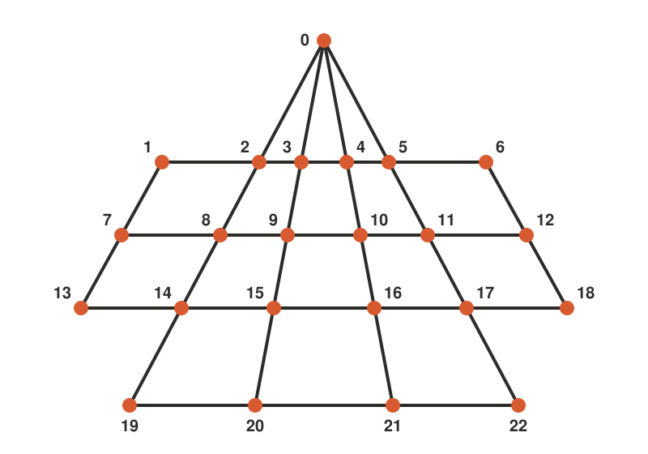

# Puli Meka AI

An AI that learns to play Puli Meka, a traditional South Indian hunting game.

## The game

- 3 tigers vs. 15 goats on a 23-point board.
- Goats are placed one per turn, then move along the lines.
- Tigers capture a goat by jumping over it.
- **Tigers win** by capturing goats. **Goats win** by trapping every tiger.

Full rules: [docs/RULES.md](docs/RULES.md)

## Approach

1. **Game engine**: the board as a graph, with every move generated from its straight lines.
2. **Baseline**: minimax search with a hand-written evaluation.
3. **Learning agent**: learns its evaluation by playing against itself.

Design choices: [docs/DESIGN.md](docs/DESIGN.md)

## Results

_Coming soon._

## Setup

_Coming soon._
